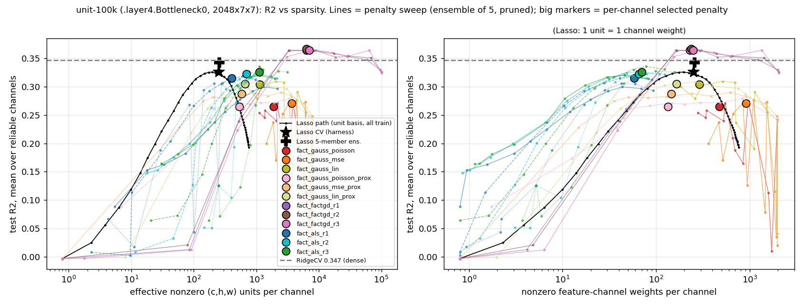
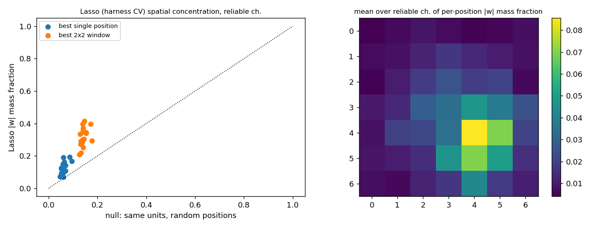
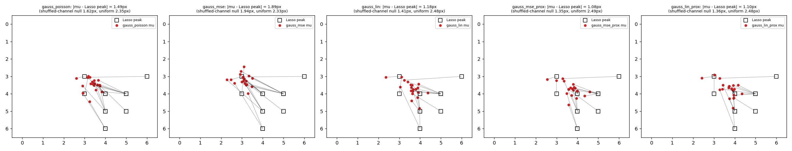
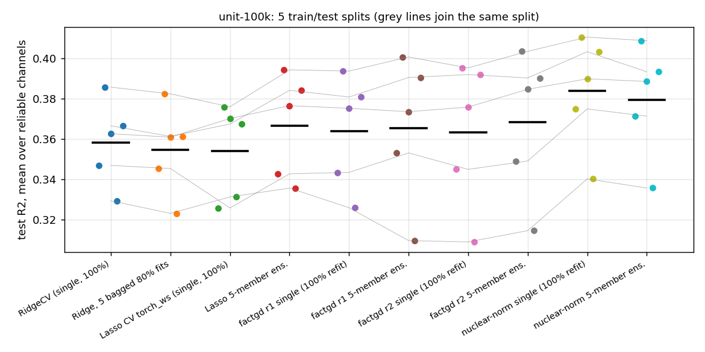
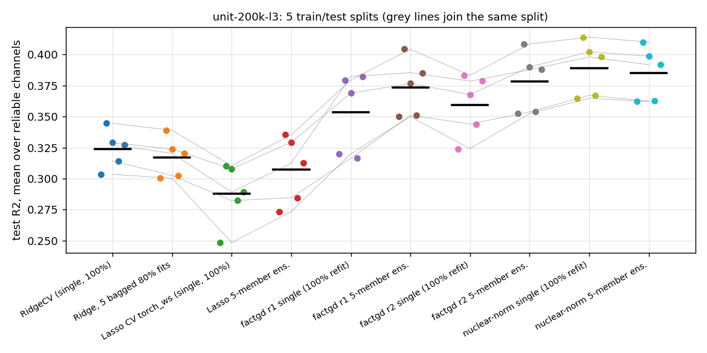
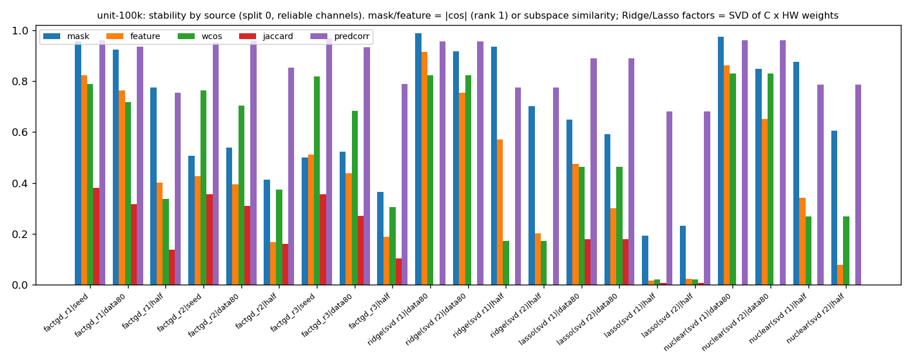
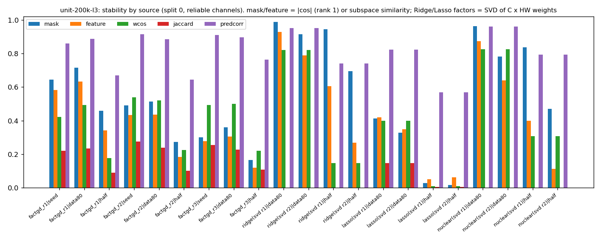

# factorized-readout: Gaussian point readout and space x feature factorized readouts vs unit-basis Lasso

Session `factorized-readout`. Code: `lassobench/factorized/` (package), `scripts/dev_fact_*.py`, `slurm/fact_*.sh`.
Raw outputs: `STORE/results/factorized/<tier>/` (`STORE` = `/n/holylabs/LABS/kempner_alvarez_lab/Lab/binxuwang/Projects/LassoSolver`).

## 0. Summary

**Round 2 (section 9) corrects round 1's factgd claim.**
- Single model against single model, factgd ties Ridge on layer4 (+0.006, SE 0.004, 5 splits).
- It beats Ridge on layer3: +0.030 / +0.036 for rank 1 / 2, on 5/5 splits.
- A convex nuclear-norm low-rank readout is better than both: +0.026 (SE 0.004) on layer4 and +0.066 (SE 0.004)
  on layer3, on 5/5 splits each. It also has no seed dependence.
- factgd's rank-1 spatial mask is stable on layer4 (|cos| 0.93 across 80% subsets, 0.78 across disjoint halves)
  but not on layer3 (0.46-0.72).
- The feature vector is not reproducible across disjoint halves on either layer (|cos| 0.34-0.40).
- Recommendation: switch the factorized line to nuclear-norm regression.

Round 1:

- **The Gaussian point readout (dualneuron) is not competitive here.** On `unit-100k` the faithful model
  (BN + ReLU, ELU+1, Poisson) gets test R2 0.265 over the 20 reliable channels (5-member ensemble; single member
  0.212). RidgeCV gets 0.347 and harness Lasso 0.326. The best Gaussian variant, the linear one, gets 0.305.
  On layer3 (14 x 14) the Gaussian readouts reach 0.26-0.28 against Ridge 0.303.
- **The reference's L1 does not make anything sparse.** Its L1 is a subgradient term under Adam, and no channel
  weight ever reaches exactly zero. Pruned at 1% of max |w|, the selected models still use 300-900 of 2048
  channels (about 1,100-3,700 effective units). Raising gamma first destroys R2 (`gauss_mse`, gamma 100: R2 0.01-0.02 per member
  with about 1,976 channels still nonzero). A proximal step (`_prox`) fixes this: same R2 at 135-166 channels (540-660 units).
- **Rank-1..3 space x feature readouts by gradient descent (`factgd`) are the best predictors measured:** 0.364-0.367
  on unit-100k and 0.350-0.351 on layer3, above RidgeCV (0.347 / 0.303). They use only ~2.1k-6.3k parameters per
  channel, but are spatially dense: about 230-250 channels x 28 positions, about 6,300-7,000 effective units on
  layer4 and 15k-23k on layer3.
- **Counted in unit-basis nonzeros, Lasso is still the sparsest route.** Below about 300 units per channel the
  Lasso path is above every factorized model on both layers. ALS reaches Lasso's R2 (0.315-0.326 ensemble) only at
  400-1,100 units, but uses only **59-70 distinct feature channels**, where Lasso uses about 250 units.
- **Lasso is not point-like.** Its selected units cover 45 of 49 positions. The best position holds 12% of |w|
  and the best 2 x 2 window 32%, about 2x a random-position null (6% / 14%). On layer3: 4% / 11%, against a null
  of 3% / 6%. The Gaussian `mu` lands near Lasso's centre of mass (0.31-0.74 px), but barely closer than a
  shuffled-channel null (0.59-0.81 px). All channels' RFs sit in the same central 3 x 3 region. Rank-1 ALS puts
  its spatial peak on the Lasso peak in 60% of reliable channels, against 19% for shuffled channels.
- **No method is stable.** Pairwise support Jaccard across the 5 members is 0.06-0.26 for every model, Lasso
  included (0.16). Weight cosine is 0.36-0.64.
- **Recommendation (section 7):** do not replace unit-basis Lasso with a Gaussian point readout. A factorized
  readout is worth pursuing as a *feature-channel*-sparse model (ALS, ~60 channels) and as a better-than-Ridge
  dense predictor (`factgd`). It is not a way to get fewer unit-basis weights.

All numbers below are from a single run of each protocol: 5 members with seeds 1..5, one train/test split.
"single member" columns give the mean and SD over those 5 members. Nothing was repeated across independent
protocol runs.

## 3. Results, unit-100k (resnet50_robust layer4.Bottleneck0, 2048 x 7 x 7 = 100,352 units)

Test split = the tier's 206 images; R2 = mean over the 20 reliable channels (reliability >= 0.5), tier Y units.
corr = Pearson correlation of the prediction with the repeat-averaged test response, the reference's metric, mean
over reliable channels. Factorized rows: 5-member ensemble with the penalty chosen per channel, pruned weights.
Ch. = nonzero channel weights per channel. Units = effective (c,h,w) units per member; union = across the 5
members, i.e. the ensemble's actual support. Time = wall-clock of the whole sweep (12 gammas x 5 members, or 30
ALS penalties x 5 members) on one NVIDIA H200. Jaccard / cosine / dpos = pairwise across members on reliable
channels: support Jaccard, cosine of channel-weight vectors (Gaussian) or of unit-basis weights (factorized /
Lasso), and distance between members' read positions (Gaussian mu, otherwise the peak of sum_c |w|).

| model | loss | R2 ens | R2 single member | corr | params / ch | ch. | units | union | time (s) | Jaccard | cos | dpos (px) |
|---|---|---|---|---|---|---|---|---|---|---|---|---|
| RidgeCV (harness, CPU) | ridge | 0.347 | | | 100,352 | 2048 | 100,352 | | 2.8 (CPU) | | | |
| Lasso CV (harness torch_ws) | lasso | 0.326 | | | 100,352 | | 252 (129 all ch.) | | 33 (H200; 6.6 in my rerun) | | | |
| Lasso, 5-member protocol | lasso | 0.343 | 0.306 ± 0.006 | | 100,352 | | 257 | 862 | 136 (H200) | 0.16 | 0.44 | 0.50 |
| fact_gauss_poisson (a, faithful) | Poisson, ELU+1 | 0.265 | 0.212 ± 0.013 | 0.524 | 2,116 | 473 | 1,885 | 7,390 | 113 | 0.08 | 0.49 | 1.16 |
| fact_gauss_mse (b) | MSE | 0.271 | 0.226 ± 0.015 | 0.526 | 2,116 | 917 | 3,668 | 13,494 | 74 | 0.10 | 0.64 | 1.37 |
| fact_gauss_lin (i) | MSE | 0.304 | 0.273 ± 0.008 | 0.558 | 2,052 | 290 | 1,148 | 4,076 | 59 | 0.14 | 0.51 | 0.71 |
| fact_gauss_poisson_prox | Poisson, ELU+1 | 0.265 | 0.223 ± 0.010 | 0.524 | 2,116 | 135 | 538 | 1,665 | 101 | 0.19 | 0.50 | 0.47 |
| fact_gauss_mse_prox | MSE | 0.288 | 0.253 ± 0.006 | 0.543 | 2,116 | 146 | 583 | 1,829 | 99 | 0.20 | 0.54 | 0.49 |
| fact_gauss_lin_prox | MSE | 0.305 | 0.271 ± 0.004 | 0.558 | 2,052 | 166 | 664 | 2,214 | 49 | 0.15 | 0.51 | 0.64 |
| fact_factgd_r1 (ii) | MSE | 0.364 | 0.345 ± 0.006 | 0.606 | 2,098 | 229 | 6,337 | 16,735 | 15 | 0.26 | 0.64 | 0.72 |
| fact_factgd_r2 (iii) | MSE | **0.367** | **0.349 ± 0.004** | **0.609** | 4,195 | 239 | 6,339 | 17,132 | 15 | 0.25 | 0.64 | 0.62 |
| fact_factgd_r3 (iii) | MSE | 0.365 | 0.347 ± 0.003 | 0.608 | 6,292 | 249 | 7,010 | 18,695 | 16 | 0.26 | 0.64 | 0.37 |
| fact_als_r1 (ii) | lasso blocks | 0.315 | 0.283 ± 0.010 | 0.574 | 2,098 | 59 | 405 | 1,302 | 240 | 0.17 | 0.49 | 0.56 |
| fact_als_r2 (iii) | lasso blocks | 0.323 | 0.281 ± 0.007 | 0.582 | 4,195 | 66 | 694 | 2,237 | 258 | 0.14 | 0.44 | 0.56 |
| fact_als_r3 (iii) | lasso blocks | 0.326 | 0.282 ± 0.011 | 0.579 | 6,292 | 70 | 1,116 | 3,962 | 251 | 0.12 | 0.43 | 0.68 |

Notes. The Lasso nonzero count in the brief (129) is the mean over all 64 channels. On the 20 reliable channels
the same harness solution has 252 nonzeros, which is the count to compare with the reliable-channel R2. The
5-member ensembling itself is worth +0.03-0.05 R2 for every method (Lasso 0.306 -> 0.343), so compare ensembles
with ensembles and single members with single members. The Gaussian "params / ch" counts f (C) + mu (2) +
sigma + bias, plus a 1/64 share of BatchNorm's 2C.

**R2-vs-sparsity frontier**: 
(`figures/factorized/unit-100k_frontier.png`). Thin lines: one ensemble per global penalty (ALS: one line per
spatial penalty frac_s). Big markers: per-channel selection. Black: Lasso path on all training rows (single fit, no
ensemble). Lasso path at reliable-channel budgets: 10 units 0.118, 31 units 0.221, 67 units 0.286, 128 units 0.319,
224 units 0.324 (the maximum, 0.326). Top-k truncation of the selected factorized models (single members, no
refit; k = channel weights for Gaussian, unit-basis weights for factorized) at k = 10 / 30 / 100 / 300 / 1000:

| model | k=10 | 30 | 100 | 300 | 1000 |
|---|---|---|---|---|---|
| Lasso path (interpolated from above, single fit) | 0.12 | 0.22 | 0.31 | 0.32 | -- |
| gauss_lin_prox (k channels, <= 4k units) | 0.157 | 0.236 | 0.272 | 0.271 | 0.271 |
| gauss_mse_prox | 0.165 | 0.224 | 0.249 | 0.253 | 0.252 |
| factgd_r2 (k units) | 0.039 | 0.092 | 0.187 | 0.283 | 0.344 |
| als_r1 (k units) | 0.147 | 0.217 | 0.268 | 0.281 | 0.283 |

Per channel weight, the Gaussian readouts are as efficient as Lasso per unit at k <= 30: 10 channels at one
position give 0.16, against 0.12 for 10 Lasso units. That advantage is lost because each channel costs up to 4
units.

## 4. Results, unit-200k-l3 (resnet50_robust layer3 output = layer3.Bottleneck5, 1024 x 14 x 14)

New tier built by `scripts/dev_fact_build_l3.py` exactly like `unit-100k` (same images, split, Y; per-column
z-score; 48 constant columns dropped, so p = 200,656). Raw maps cached at
`STORE/cache/features/resnet50_robust_layer3.B5_paul1119-1122.npy`. The harness rows (`cpu_ridgecv`, `torch_ws`
CV, tag `factorized-readout`) were run on a MIG slice (A100 3g.20gb, `gpu_model` recorded as null). The Lasso CV
rerun on H200 took 13.7 s.

| model | R2 ens | R2 single | corr | params / ch | ch. | units | union | time (s, H200) | Jaccard | cos | dpos (px) |
|---|---|---|---|---|---|---|---|---|---|---|---|
| RidgeCV (harness) | 0.303 | | | 200,656 | | dense | | 3.5 (CPU) | | | |
| Lasso CV (harness torch_ws) | 0.221 | | | 200,656 | | 383 (187 all ch.) | | 26.5 (MIG) / 13.7 (H200) | | | |
| Lasso path max (all train) | 0.233 at 187 units | | | | | | | 22.9 | | | |
| Lasso, 5-member protocol | 0.266 | 0.213 ± 0.012 | | 200,656 | | 318 | 1,120 | 126 | 0.13 | 0.39 | 2.21 |
| fact_gauss_poisson (a) | 0.261 | 0.193 ± 0.020 | 0.521 | 1,060 | 318 | 1,274 | 5,160 | 53 | 0.07 | 0.50 | 1.84 |
| fact_gauss_mse (b) | 0.279 | 0.221 ± 0.013 | 0.536 | 1,060 | 563 | 2,252 | 9,032 | 37 | 0.07 | 0.60 | 2.13 |
| fact_gauss_lin (i) | 0.280 | 0.212 ± 0.020 | 0.539 | 1,028 | 389 | 1,544 | 6,329 | 31 | 0.07 | 0.47 | 1.73 |
| fact_gauss_poisson_prox | 0.257 | 0.186 ± 0.005 | 0.520 | 1,060 | 213 | 851 | 3,330 | 32 | 0.08 | 0.48 | 1.66 |
| fact_gauss_mse_prox | 0.279 | 0.222 ± 0.007 | 0.537 | 1,060 | 353 | 1,412 | 5,649 | 34 | 0.08 | 0.54 | 1.78 |
| fact_gauss_lin_prox | 0.282 | 0.219 ± 0.012 | 0.543 | 1,028 | 267 | 1,070 | 4,450 | 26 | 0.06 | 0.47 | 1.80 |
| fact_factgd_r1 | 0.350 | 0.290 ± 0.032 | 0.597 | 1,221 | 238 | 15,823 | 49,180 | 14 | 0.19 | 0.37 | 2.44 |
| fact_factgd_r2 | **0.351** | 0.310 ± 0.004 | 0.596 | 2,441 | 220 | 14,554 | 42,473 | 14 | 0.19 | 0.39 | 2.07 |
| fact_factgd_r3 | 0.351 | **0.311 ± 0.007** | 0.597 | 3,661 | 286 | 23,478 | 64,206 | 14 | 0.20 | 0.36 | 1.84 |
| fact_als_r1 | 0.263 | 0.203 ± 0.004 | 0.523 | 1,221 | 32 | 1,054 | 3,728 | 414 | 0.14 | 0.39 | 2.28 |
| fact_als_r2 | 0.254 | 0.111 ± 0.151 | 0.521 | 2,441 | 34 | 1,021 | 3,677 | 422 | 0.13 | 0.36 | 2.48 |
| fact_als_r3 | 0.257 | 0.122 ± 0.144 | 0.522 | 3,661 | 40 | 1,383 | 5,214 | 423 | 0.14 | 0.38 | 2.28 |

Frontier: `figures/factorized/unit-200k-l3_frontier.png`. At 14 x 14, Lasso does worse relative to Ridge (0.221
vs 0.303), and the factorized readouts gain on it. With single members compared to single members, the Gaussian
readouts (0.19-0.22) roughly tie the 5-member-protocol Lasso (0.213), at 3-6x more units. `factgd` beats Ridge by
0.05.

## 5. Does Lasso already find a point-like spatial structure? (step 6)

Lasso = harness-protocol `torch_ws` CV solution, refit on all training rows (`scripts/dev_fact_lasso.py`,
coefficients in `STORE/results/factorized/<tier>/lasso.npz`). Per reliable channel: mass = sum_c |w| at each
position. Null: same selected units, same weights, each moved to a uniformly random position (200 draws).

| tier | positions used (of H*W) | best position | null | best 2x2 window | null |
|---|---|---|---|---|---|
| unit-100k (7x7) | 45.1 / 49 | 0.123 | 0.061 | 0.315 | 0.142 |
| unit-200k-l3 (14x14) | 143.6 / 196 | 0.041 | 0.032 | 0.106 | 0.059 |



Lasso concentrates its weight about 2x more than chance around one spot (the population RF, row 4 / col 4 of the
7x7 map). It is far from point-like: about 70% of |w| (layer4) or 90% (layer3) lies outside the best 2x2 window.

Position agreement (reliable channels, `STORE/results/factorized/<tier>/mu_vs_lasso.json`,
):

| tier | model | mean mu-to-Lasso-peak distance (px) | shuffled-channel null | mu-to-Lasso-centre-of-mass distance (px) | null | uniform null (px) |
|---|---|---|---|---|---|---|
| 100k | gauss_poisson | 1.49 | 1.62 | 0.39 | 0.59 | 2.35 |
| 100k | gauss_lin | 1.18 | 1.41 | 0.34 | 0.62 | 2.47 |
| 100k | gauss_lin_prox | 1.10 | 1.36 | 0.31 | 0.66 | 2.50 |
| l3 | gauss_poisson | 2.58 | 2.89 | 0.68 | 1.07 | 5.05 |
| l3 | gauss_lin_prox | 2.58 | 2.90 | 0.73 | 1.10 | 5.06 |

The rank-1 ALS mask peak (member 1) is at the Lasso peak position in 60% of reliable channels on layer4 (shuffled
null 19%; mean distance 0.47 px vs null 1.18). On layer3: 20%, null 3%.

Interpretation: the Gaussian mu sits at Lasso's spatial centre of mass, a bit closer than for a random other
channel. All 20 reliable channels have RFs in the same central region, so per-channel spatial information is weak at
this resolution: the uniform null is 2.4 px and every method lands within about 1 px of every channel. Lasso
spreads its weight over many positions instead of reading one point. The single-point constraint costs 0.04
(layer4, best Gaussian vs Ridge) to 0.02 R2 (layer3, Gaussian vs Ridge 0.303), and gains nothing in unit-basis
sparsity.

## 6. What failed or needed fixing

- **Subgradient L1 under Adam** (the reference's regularizer) gives no exact zeros and no useful sparsity. Large
  gamma shrinks all weights to the ~lr scale together, so relative pruning removes almost nothing while R2 collapses.
  Replaced by the preconditioned proximal step for the `_prox` / `factgd` models.
- **ALS scale drift**: with L1 on both factors and no normalization, the spatial mask grew to undo the feature
  penalty, and a component whose factor hit zero stayed dead for the rest of the path (first smoke run: all-zero
  features at 3 of 8 penalties, worse R2 at lower penalties). Fixed by the unit-L2 mask rescaling and by keeping the
  old mask for dead components. The alternation is a heuristic, not a monotone descent.
- **ALS speed**: per-channel design matrices (T x n x rC) and batched matrix-vector products ran at 15 s per path
  point on a MIG A100 slice. Rewriting both block solves as two shared GEMMs with X (`als._Ops`; checked against the
  explicit designs to 1e-5 and against the old FISTA to 4e-7) brought this to 1.7 s on H200. ALS is still the
  slowest method (4-7 min for 30 penalties x 5 members). `factgd` takes 15 s and harness Lasso CV 7-34 s.
- **ALS rank 2-3 on layer3 is unstable**: single members have R2 0.111 ± 0.151, because some members have
  catastrophic channels. The ensemble (0.254-0.257) hides it. Rank-1 is fine (0.203 ± 0.004).
- ALS selects the near-empty penalty for 8 (layer4) / 14 (layer3) of 64 channels, presumably the unreliable
  channels (validation R2 <= 0 at every penalty); not checked channel by channel.
- The faithful Poisson model is trained on max(R, 0) of normalized responses. That is not the reference's data
  regime (spike counts), and it is the weakest variant on R2. Raw trial-level spike counts were not used.
- **Dev rows only**: the `fact_*` rows were produced before the package was committed, so their `git_dirty` lists
  `lassobench/factorized/*`. Under spec section 7 they are not ranked; rerunning `slurm/fact_train.sh` from the
  committed code (about 25 H200-minutes per tier) would make them count.

## 7. Recommendation

1. **Gaussian point readout: drop it as a sparse alternative.** On unit-basis cost it loses to Lasso on both layers
   (Lasso path: 0.32 at about 130-250 units; Gaussian ensembles: 0.27-0.31 at 540-3,700 units). Its own L1 does not sparsify, and
   it is the least stable model (support Jaccard 0.06-0.20).
2. **Unit-basis sparsity is Lasso's game.** No factorized model reaches the Lasso frontier below about 300 units. A
   readout built from products of factors pays for every channel at several positions.
3. **Two things the factorization does better, worth a follow-up:**
   (a) *Feature-channel identifiability.* ALS reaches Lasso-level R2 (0.315-0.326 ensemble, 0.28 single) using about
   60-70 DNN channels per neuron, against about 250 distinct units for Lasso. If the scientific question is "which
   features", this is the sparser answer. Next step: rank-1 with a group-sparse or smooth (not single-point)
   spatial mask, a relaxed refit on the selected channels, and stability measured on channel sets instead of
   (c,h,w) units.
   (b) *Prediction.* [Round 2, section 9: this compared an ensemble with a single Ridge fit. Single against
   single it is a tie on layer4 and +0.03 on layer3, and nuclear-norm regression beats it.] Low-rank space x
   feature (`factgd`, rank 1-2, proximal L1) beats RidgeCV on both layers
   (+0.02 layer4, +0.05 layer3) at 15 s on H200, and is more stable (weight cosine 0.64 on layer4). It is the
   strongest dense baseline found so far and should be added to the leaderboard's reference lines.
4. Stability is poor for every method (Jaccard <= 0.26). Neither Lasso nor any factorization gives an identifiable
   support with n = 822 images. Ensembling helps R2 for all methods but multiplies the support by 3-4x.

## 8. Requests for the coordinator

- `api.py` / spec: consider a "nonzero channels" sparsity axis next to nonzero units, so feature-channel-sparse
  models can be ranked (section 7.3a), and say whether ensembles may be ranked against single fits.
- Spec section 9: the 129-nonzero Lasso figure is an all-channel mean; reliable-channel R2 should be paired with the
  reliable-channel count (252).
- New tier `unit-200k-l3` lives in `STORE/data/`, built by `scripts/dev_fact_build_l3.py`, and its builder should
  probably move into the harness's `build_unit_tiers.py`. Its harness rows were run on a MIG slice and should be
  rerun on a full H200 if they are to be ranked.

## 9. Round 2: is factgd really better than Ridge, and is it stable?

Code: `lassobench/factorized/round2.py` (runs), `summarize_round2.py` (tables, rows, figures), commits `9034aa5`..`19f4752`.
Raw: `STORE/results/factorized/<tier>/round2/` (and `round2_clip/`, see 9.1). GPU: H200 for every round-2 run.
Rows: `fact_r2_*`, tag `factorized-readout-round2` (row R2 = split 0 = the tier's own split; split statistics in
extra metric keys).

### 9.1 Protocol

- **Splits.** 5 train/test splits of the 1028 images, all with 206 test images. Split 0 is the tier's own split.
  Split k >= 1 is a `RandomState(1000 + k)` permutation, with X columns and Y re-z-scored on that split's training
  rows. The reliable-channel mask is the tier's (20 channels on both tiers). All penalties, epochs and alphas are
  chosen inside the training part; the test part is only predicted.
- **Models per split.** Ridge and Lasso use the harness code paths:
  - **RidgeCV**: per-target LOO-GCV.
  - **Ridge bag5**: RidgeCV on each of five `RandomState(m)` 80% subsets, predictions averaged.
  - **Lasso CV**: `torch_ws.fit_cv` with the harness folds and grid and the min-CV alpha; one fit on all
    training rows.
  - **Lasso 5-member ensemble**: per-channel alpha chosen by member validation R2.
  - **factgd rank r**:
    1. Penalty grid × 5 members, giving a per-channel gamma* by mean member validation R2 of the pruned model.
    2. The 5 members retrained at the gamma* vector form the **ensemble**.
    3. The **single model** is refit on **100%** of the training rows at gamma*, with member 1's learning-rate
       schedule cut at its best epoch (item 4).
  - **Nuclear norm**: `min 1/(2n)|y - <X, W>|^2 + lam |W|_*`, where W is the C × HW matrix of each channel.
    Solved by FISTA with singular-value thresholding. Per-channel lam is chosen by member validation, then the
    model is refit on 100%.
- **Variability sources, split 0 only, at the penalty and schedule chosen above.** Each run trains with that
  fixed schedule and no validation.
  - (a) Seed: the same 100% of the training rows, init and batch-order seeds 1..8.
  - (b) Data, init seed 1:
    - five 80% subsets (each pair shares at least 60% of the rows);
    - the two **disjoint halves** (`runner.half_split`). This is the honest data-change test.
  - Ridge, Lasso and nuclear norm are refit at the all-rows per-channel penalties. They are convex and
    deterministic, so (a) does not apply. Ridge alpha is scaled by n_sub/n; the Lasso and nuclear objectives are
    1/(2n), so their alpha is not rescaled.
- **Factor stability, per reliable channel, mean over run pairs.**
  - Spatial mask and feature vector: rank 1 uses |cos|, which removes sign and scale. Rank 2-3 uses subspace
    similarity, the mean squared cosine of the principal angles, which removes the rotation between components.
  - Weight cosine: computed on the reconstructed C × HW weights.
  - Support Jaccard: on the pruned support; dense models get n/a.
  - Test-prediction correlation between runs.
  - Ridge, Lasso and nuclear norm get the same factor treatment through the rank-1 / rank-2 SVD of each channel's
    C × HW weight matrix.
- **Layer3 test-set outliers.** Layer3 maps are sparse after the ReLU: 595 of 200k columns are active in at most
  1% of images. z-scored on the training rows, some test values reach 4,748 even on the tier's own split, and
  6,460 on splits 1 and 4 (`scripts/dev_fact_diag_split.py`). Per-unit Lasso and Ridge then blow up on some
  splits: Lasso CV test R2 averages -210 over the 5 splits. For layer3 everything is therefore also run with each
  test column clipped to its training-row range (`--clip`, training statistics only, `round2_clip/`), and the
  conclusions use that version. On layer4 the largest test value is 85, so clipping does nothing there and was
  not run.

Every number below comes from one run of this protocol: 5 splits; 5 members, 8 seeds and 7 subsets on split 0.
SE across channels = SD of the 20 per-channel differences / sqrt(20). SE across splits = SD of the 5 split-mean
differences / sqrt(5).

### 9.2 Single model vs Ridge, and ensembles (item 3)

**unit-100k** (layer4, 2048 × 7 × 7). Test R2, mean over the 20 reliable channels.

| model | split 0 | mean ± SD, 5 splits | diff vs RidgeCV, split 0 (SE ch.) | diff vs RidgeCV, 5 splits (SE splits) | splits better | nonzero units |
|---|---|---|---|---|---|---|
| RidgeCV (single, 100%) | 0.347 | 0.358 ± 0.021 | — | — | — | dense |
| Ridge, 5 bagged 80% fits | 0.345 | 0.355 ± 0.022 | -0.002 (0.002) | -0.004 (0.001) | 0/5 | dense |
| Lasso CV torch_ws (single, 100%) | 0.326 | 0.354 ± 0.024 | -0.021 (0.009) | -0.004 (0.005) | 3/5 | 265 |
| Lasso 5-member ens. | 0.343 | 0.367 ± 0.026 | -0.004 (0.007) | +0.008 (0.004) | 4/5 | 281 / member |
| **factgd r1 single (100% refit)** | 0.343 | 0.364 ± 0.028 | -0.003 (0.011) | **+0.006 (0.004)** | 3/5 | 10,597 |
| factgd r1 5-member ens. | 0.353 | 0.365 ± 0.036 | +0.006 (0.007) | +0.007 (0.007) | 4/5 | 9,305 / member |
| **factgd r2 single (100% refit)** | 0.345 | 0.363 ± 0.036 | -0.002 (0.009) | **+0.005 (0.008)** | 3/5 | 11,732 |
| factgd r2 5-member ens. | 0.349 | 0.368 ± 0.036 | +0.002 (0.009) | +0.010 (0.007) | 4/5 | 10,022 / member |
| **nuclear norm single (100% refit)** | **0.375** | **0.384 ± 0.028** | **+0.028 (0.004)** | **+0.026 (0.004)** | **5/5** | dense, rank 3.9 |
| nuclear norm 5-member ens. | 0.371 | 0.379 ± 0.028 | +0.024 (0.003) | +0.021 (0.004) | 5/5 | dense |
| Ridge, one 80% fit | 0.333 | 0.343 ± 0.022 | -0.014 (0.002) | -0.015 (0.001) | 0/5 | dense |
| Lasso, one 80% member | 0.306 | 0.325 ± 0.024 | -0.041 (0.009) | -0.033 (0.003) | 0/5 | 281 |
| factgd r1, one 80% member | 0.334 | 0.347 ± 0.039 | -0.012 (0.009) | -0.011 (0.009) | 1/5 | 9,305 |
| factgd r2, one 80% member | 0.334 | 0.350 ± 0.039 | -0.013 (0.009) | -0.009 (0.009) | 3/5 | 10,022 |
| nuclear norm, one 80% member | 0.358 | 0.367 ± 0.028 | +0.011 (0.004) | +0.009 (0.004) | 4/5 | dense |

Ensemble against ensemble: factgd r1 ens5 minus Ridge bag5 is +0.011 (SE across splits 0.007); r2: +0.014 (0.007).

**unit-200k-l3** (layer3, 1024 × 14 × 14), test columns clipped to training ranges (`round2_clip/`). The
layer3 split runs used a MIG slice (A100 3g.20gb); timings there are not comparable.

| model | split 0 | mean ± SD, 5 splits | diff vs RidgeCV, split 0 (SE ch.) | diff vs RidgeCV, 5 splits (SE splits) | splits better | nonzero units |
|---|---|---|---|---|---|---|
| RidgeCV (single, 100%) | 0.303 | 0.324 ± 0.016 | — | — | — | dense |
| Ridge, 5 bagged 80% fits | 0.300 | 0.317 ± 0.016 | -0.003 (0.002) | -0.007 (0.001) | 0/5 | dense |
| Lasso CV torch_ws (single, 100%) | 0.248 | 0.288 ± 0.025 | -0.055 (0.016) | -0.036 (0.006) | 0/5 | 364 |
| Lasso 5-member ens. | 0.274 | 0.307 ± 0.027 | -0.030 (0.009) | -0.017 (0.006) | 1/5 | 352 / member |
| **factgd r1 single (100% refit)** | 0.320 | 0.353 ± 0.033 | +0.017 (0.015) | **+0.030 (0.009)** | 5/5 | 21,385 |
| factgd r1 5-member ens. | 0.350 | 0.373 ± 0.023 | +0.047 (0.009) | +0.050 (0.004) | 5/5 | 18,185 / member |
| **factgd r2 single (100% refit)** | 0.324 | 0.360 ± 0.025 | +0.021 (0.014) | **+0.036 (0.005)** | 5/5 | 19,884 |
| factgd r2 5-member ens. | 0.353 | 0.379 ± 0.025 | +0.049 (0.011) | +0.055 (0.005) | 5/5 | 17,868 / member |
| **nuclear norm single (100% refit)** | **0.365** | **0.389 ± 0.022** | **+0.061 (0.008)** | **+0.066 (0.004)** | **5/5** | dense, rank 4.4 |
| nuclear norm 5-member ens. | 0.362 | 0.385 ± 0.022 | +0.059 (0.007) | +0.061 (0.004) | 5/5 | dense |
| Ridge, one 80% fit | 0.289 | 0.306 ± 0.016 | -0.014 (0.002) | -0.018 (0.002) | 0/5 | dense |
| Lasso, one 80% member | 0.227 | 0.255 ± 0.026 | -0.076 (0.010) | -0.068 (0.006) | 0/5 | 352 |
| factgd r1, one 80% member | 0.306 | 0.333 ± 0.025 | +0.002 (0.011) | +0.009 (0.005) | 4/5 | 18,185 |
| factgd r2, one 80% member | 0.316 | 0.344 ± 0.026 | +0.012 (0.012) | +0.020 (0.005) | 5/5 | 17,868 |
| nuclear norm, one 80% member | 0.351 | 0.373 ± 0.022 | +0.047 (0.007) | +0.049 (0.004) | 5/5 | dense |

Ensemble against ensemble: factgd r1 ens5 minus Ridge bag5 is +0.056 (SE across splits 0.004); r2: +0.061 (0.004).

The same layer3 runs without clipping (`round2/`) show the outlier problem:
- RidgeCV: 0.246 ± 0.098 over splits.
- Lasso CV: -210 ± 301, below -100 on two splits.
- factgd is almost unaffected: r1 single 0.352 ± 0.034, r2 single 0.358 ± 0.026.

The factorized readout shares one feature vector across positions, so it puts little weight on rare,
single-position units. A per-unit model can bet on such a unit and then blow up on test images where it fires.
Even on the tier's own split, clipping raises Lasso CV from 0.221 to 0.248. The layer3 harness rows are therefore
affected by this too.




### 9.3 Stability: seeds vs data (items 1, 2)

**unit-100k**, split 0. Similarities: |cos| for rank 1; subspace similarity for rank 2-3 and for the rank-2 SVD
rows. Ridge, Lasso and nuclear-norm factors are the SVD of their C × HW weights.

| model / source | runs | test R2 | spatial mask | feature vector | weight cos. | support Jaccard | pred. corr. |
|---|---|---|---|---|---|---|---|
| factgd r1, seeds | 8 | 0.346 ± 0.006 | 0.956 | 0.824 | 0.789 | 0.381 | 0.961 |
| factgd r1, 80% subsets | 5 | 0.329 ± 0.007 | 0.925 | 0.763 | 0.718 | 0.316 | 0.936 |
| factgd r1, disjoint halves | 2 | 0.243 ± 0.054 | 0.775 | 0.401 | 0.338 | 0.137 | 0.755 |
| factgd r2, seeds | 8 | 0.343 ± 0.007 | 0.506 | 0.427 | 0.763 | 0.356 | 0.953 |
| factgd r2, 80% subsets | 5 | 0.329 ± 0.009 | 0.539 | 0.394 | 0.703 | 0.310 | 0.958 |
| factgd r2, halves | 2 | 0.265 ± 0.029 | 0.414 | 0.167 | 0.373 | 0.159 | 0.853 |
| factgd r3, seeds | 8 | 0.355 ± 0.006 | 0.500 | 0.512 | 0.818 | 0.355 | 0.969 |
| factgd r3, halves | 2 | 0.272 ± 0.026 | 0.365 | 0.188 | 0.304 | 0.104 | 0.789 |
| Ridge (SVD r1), 80% subsets | 5 | 0.333 ± 0.007 | 0.989 | 0.916 | 0.824 | n/a | 0.957 |
| Ridge (SVD r1), halves | 2 | 0.299 ± 0.010 | 0.936 | 0.570 | 0.172 | n/a | 0.776 |
| Ridge (SVD r2), halves | 2 | 0.299 ± 0.010 | 0.702 | 0.203 | 0.172 | n/a | 0.776 |
| Lasso (SVD r1), 80% subsets | 5 | 0.310 ± 0.008 | 0.649 | 0.474 | 0.462 | 0.179 | 0.890 |
| Lasso (SVD r1), halves | 2 | 0.269 ± 0.009 | 0.192 | 0.015 | 0.021 | 0.006 | 0.681 |
| nuclear (SVD r1), 80% subsets | 5 | 0.358 ± 0.001 | 0.976 | 0.862 | 0.830 | n/a | 0.962 |
| nuclear (SVD r1), halves | 2 | 0.309 ± 0.018 | 0.877 | 0.342 | 0.269 | n/a | 0.787 |
| nuclear (SVD r2), halves | 2 | 0.309 ± 0.018 | 0.607 | 0.079 | 0.269 | n/a | 0.787 |

Cross-method: the factgd r1 mask has |cos| 0.914 with Ridge's top spatial singular vector, and its feature vector
0.518 with Ridge's top feature singular vector.

**unit-200k-l3**, split 0. The factor, weight and support columns use training data only, so clipping does not
change them. The test-R2 and prediction-correlation columns are unclipped.

| model / source | runs | test R2 | spatial mask | feature vector | weight cos. | support Jaccard | pred. corr. |
|---|---|---|---|---|---|---|---|
| factgd r1, seeds | 8 | 0.315 ± 0.015 | 0.644 | 0.584 | 0.421 | 0.221 | 0.860 |
| factgd r1, 80% subsets | 5 | 0.286 ± 0.036 | 0.716 | 0.633 | 0.493 | 0.233 | 0.887 |
| factgd r1, halves | 2 | 0.218 ± 0.033 | 0.458 | 0.341 | 0.177 | 0.090 | 0.670 |
| factgd r2, seeds | 8 | 0.319 ± 0.007 | 0.490 | 0.434 | 0.538 | 0.275 | 0.915 |
| factgd r2, 80% subsets | 5 | 0.306 ± 0.007 | 0.513 | 0.435 | 0.520 | 0.238 | 0.885 |
| factgd r2, halves | 2 | 0.233 ± 0.031 | 0.273 | 0.182 | 0.224 | 0.102 | 0.644 |
| factgd r3, seeds | 8 | 0.320 ± 0.010 | 0.300 | 0.276 | 0.493 | 0.254 | 0.910 |
| factgd r3, halves | 2 | 0.262 ± 0.013 | 0.165 | 0.118 | 0.220 | 0.107 | 0.763 |
| Ridge (SVD r1), 80% subsets | 5 | 0.288 ± 0.004 | 0.989 | 0.928 | 0.822 | n/a | 0.953 |
| Ridge (SVD r1), halves | 2 | 0.254 ± 0.003 | 0.945 | 0.605 | 0.147 | n/a | 0.741 |
| Lasso (SVD r1), 80% subsets | 5 | 0.208 ± 0.016 | 0.413 | 0.419 | 0.398 | 0.147 | 0.823 |
| Lasso (SVD r1), halves | 2 | 0.126 ± 0.046 | 0.028 | 0.050 | 0.010 | 0.003 | 0.569 |
| nuclear (SVD r1), 80% subsets | 5 | 0.348 ± 0.006 | 0.963 | 0.874 | 0.826 | n/a | 0.961 |
| nuclear (SVD r1), halves | 2 | 0.307 ± 0.003 | 0.836 | 0.400 | 0.307 | n/a | 0.793 |

Cross-method: the factgd r1 mask has |cos| 0.675 with Ridge's top spatial singular vector, and its feature vector
0.547 with Ridge's top feature singular vector.




### 9.4 Ablations: why it works (item 5), split 0

| variant | unit-100k single | ens5 | unit-200k-l3 single | ens5 |
|---|---|---|---|---|
| RidgeCV | 0.347 | — | 0.303 | — |
| factgd r1 (L1 on mask and features) | 0.343 | 0.353 | 0.317 | 0.347 |
| factgd r2 | 0.345 | 0.349 | 0.319 | 0.351 |
| factgd r3 | 0.362 | 0.358 | 0.318 | 0.350 |
| r1, L1 on features only | 0.311 | 0.326 | 0.197 | 0.302 |
| r1, L1 on mask only | 0.315 | 0.339 | 0.268 | 0.325 |
| r1, no L1 | 0.271 | 0.330 | 0.075 | 0.253 |
| r2, no L1 | 0.240 | 0.326 | -0.064 | 0.254 |
| r1, non-negative mask | 0.345 | 0.348 | 0.324 | 0.338 |
| r2, non-negative mask | 0.345 | 0.341 | 0.331 | 0.345 |
| r1, smooth mask (roughness penalty) | 0.338 | 0.337 | 0.325 | 0.341 |
| r1, non-negative + smooth | 0.341 | 0.340 | 0.327 | 0.344 |
| Ridge, then truncated SVD, rank 1 | 0.303 | — | 0.219 | — |
| Ridge, then truncated SVD, rank 2 | 0.345 | — | 0.264 | — |
| Ridge, then truncated SVD, rank 3 | 0.350 | — | 0.289 | — |
| **nuclear norm (convex, rank by CV)** | **0.375** | 0.371 | **0.364** | 0.361 |

The layer3 column is the tier's own split without clipping. Its Ridge and Lasso values match the harness rows
(0.303 and 0.221). SE of a single-model difference vs Ridge on split 0 is
0.004-0.018 (layer4) and 0.008-0.037 (layer3); see `summary.json`.

### 9.5 Scale check: unit-800k (layer1, 256 × 56 × 56 = 802,816 maps, 779,947 kept columns) (item 6)

- **Cost.** On an H200, factgd rank 1 trains one member in about 0.4 s after warm-up (23 epochs, 0.018 s per
  epoch). The full selection protocol takes 21 s for rank 1 and 25 s for rank 2: 17 gammas × 5 members, then
  5 retrained members and 1 refit, 91 fits in all. Peak GPU memory is 8.9 GB, and the data on the GPU is 2.6 GB.
- **Accuracy.** Test R2 on the reliable channels is poor:
  - factgd r1: 0.025 single, 0.031 ensemble.
  - factgd r2: 0.026 single, 0.049 ensemble.
  - The harness rows on the same tier give RidgeCV 0.125 and Lasso CV 0.033.

  So factgd runs at this scale without trouble but does not help on this early layer. No channel chose the top
  gamma, so the grid was not the limit.
- **Nuclear norm was not run at 800k.** Its SVT uses the HW × HW Gram, which is 3136 × 3136 here. It should switch
  to the C × C side (256 × 256) first. This is a small change and a follow-up.
- Raw output: `STORE/results/factorized/unit-800k/round2/timing.npz`.

### 9.6 Answers

**1. Is factgd better than Ridge, single model against single model?**
- **Layer4 (unit-100k): no.** The gain is within noise:
  - rank 1: +0.006 R2 (SE 0.004 across splits);
  - rank 2: +0.005 (SE 0.008);
  - on the tier's own split, rank 1 is -0.003 (SE 0.011 across channels).

  Round 1's "+0.02 over Ridge" compared a 5-member ensemble with a single Ridge fit. Ensemble against ensemble,
  the gain over bagged Ridge is +0.011 / +0.014 (SE 0.007), under 2 SE.
- **Layer3 (unit-200k-l3, clipped): yes**, better on all 5 splits:
  - rank 1: +0.030 (SE 0.009);
  - rank 2: +0.036 (SE 0.005);
  - ensembles: +0.056 / +0.061 over bagged Ridge (SE 0.004).

  This is the higher-resolution map (14 × 14), where a per-unit Ridge has 4× more spatial copies of each feature
  to spread its weight over.
- **Gradient descent is not needed for this gain.** The convex nuclear-norm model, with rank chosen per channel by
  validation (about 4), is the best single model measured:
  - Layer4: +0.026 (SE 0.004), better on 5/5 splits.
  - Layer3 (clipped): +0.066 (SE 0.004), better on 5/5 splits. That is about twice factgd's gain.

  Ridge followed by a truncated SVD is worse than Ridge (rank 1: 0.303 / 0.219). The low-rank structure has to be
  imposed during the fit, not afterwards.

**2. Is what it infers stable?** Rank 1 is the only identifiable case. Values are |cos| between runs on reliable
channels, in the order seeds / 80% subsets / disjoint halves.
- **Spatial mask.**
  - Layer4: 0.956 / 0.925 / 0.775. Stable.
  - Layer3 (196 positions): 0.644 / 0.716 / 0.458. Not stable, even under a seed change.
- **Feature vector.**
  - Layer4: 0.824 / 0.763 / 0.401.
  - Layer3: 0.584 / 0.633 / 0.341.
  - Across disjoint halves (411 images each) the feature vector is not reproducible on either layer.
- **Seed vs data.**
  - On layer4, data changes move the factors more than seed changes do.
  - On layer3, the seed alone moves them as much as an 80% data subset does, or more (mask 0.644 across seeds vs
    0.716 across subsets). Here non-convexity is itself a main source of instability.
- **Rank 2-3.** The individual components are not identified: subspace similarity is 0.3-0.5 even across seeds.
  Their product W and the predictions are stable (prediction correlation across seeds 0.95-0.97 on layer4,
  0.86-0.92 on layer3).
- **Compared with the convex models' rank-1 SVD factors, factgd's factors are less stable.** Values are spatial,
  then feature, for 80% subsets / halves:

  | model | layer4 | layer3 |
  |---|---|---|
  | Ridge | 0.989 / 0.936, then 0.916 / 0.570 | 0.989 / 0.945, then 0.928 / 0.605 |
  | nuclear norm | 0.976 / 0.877, then 0.862 / 0.342 | 0.963 / 0.836, then 0.874 / 0.400 |

  On layer4, factgd's mask is close to Ridge's top spatial singular vector (|cos| 0.91). The rank-1 mask is
  therefore mostly what Ridge already contains, recovered less stably.
- **Lasso is the least stable model** across halves: support Jaccard 0.003-0.006, weight cosine 0.01-0.02.
- **Predictions are more stable than any parameter.** Test-prediction correlation across disjoint halves is:
  - factgd: 0.64-0.85;
  - Ridge: 0.74-0.78;
  - nuclear norm: 0.79;
  - Lasso: 0.57-0.68.

**3. Why it works (ablations, split 0).**
- L1 on both factors is required. Dropping it from either factor costs 0.02-0.03 R2 single on layer4 and
  0.01-0.12 on layer3. With no L1 at all, R2 falls to 0.24-0.27 single (layer4) and below 0.08 (layer3).
- A non-negative or smooth mask does not change layer4 (within ±0.008). On layer3 it gives +0.007 to +0.012
  single, which is under 1 SE.
- Rank 3 is the best factgd rank on layer4 (0.362 single). The nuclear-norm model selects about rank 4. Rank 1-2
  is too low for prediction.

**4. Recommendation.**
- **Do not keep factgd as the main factorized line in its current form. Replace it with nuclear-norm-regularized
  regression**, a convex low-rank readout per channel with rank chosen by CV:
  - It has the best single-model R2 on both layers.
  - It needs no seeds, so the single-vs-single comparison is clean.
  - Its leading spatial and feature factors are more stable than factgd's.
- **What factgd still offers:**
  - Speed: 20 s for the whole protocol even at 800k units, against about 7 min per split for the unoptimized
    FISTA nuclear-norm solver on layer4 and 24 min on layer3.
  - Sparse factors: about 10k-20k nonzero units, where the nuclear-norm fit is dense.
- **Next steps:**
  - A faster nuclear-norm solver (SVT on the smaller Gram side, warm starts, fewer lambdas).
  - Low-rank + sparse (nuclear + L1) if a sparse unit-basis readout is still wanted.
  - Report only rank-1 factors as interpretable. Even those carry a stable spatial mask only on layer4, and a
    feature vector that is not reproducible across disjoint halves on either layer.
- **Layer3 data issue:** test-time outliers on the sparse layer3 maps break per-unit linear readouts. If layer3
  tiers are kept, the tier builder should clip (or drop near-constant columns), and the harness rows should be
  rerun.

All round-2 numbers come from one run of each protocol (5 splits; 5 members, 8 seeds and 7 subsets on split 0).
The split SDs and SEs are the only between-run spreads measured.

## Reproduce

Round 2:

```
sbatch -p gpu_h200 slurm/fact_round2.sh --tier unit-100k --parts splits,stab,ablate
for k in 0 1 2 3 4; do sbatch -p gpu_h200 slurm/fact_round2.sh --tier unit-100k --parts nuclear --splits $k; done
sbatch -p gpu_h200 slurm/fact_round2.sh --tier unit-200k-l3 --parts splits,stab,ablate      # unclipped
sbatch -p gpu_h200 slurm/fact_round2.sh --tier unit-200k-l3 --parts nuclear --splits 0      # nuclear stability
for k in 0 1 2 3 4; do sbatch -p gpu_h200 slurm/fact_round2.sh --tier unit-200k-l3 --parts splits,nuclear --splits $k --clip; done
sbatch -p gpu_h200 slurm/fact_round2.sh --tier unit-800k --parts timing
sbatch slurm/fact_cpu.sh -m lassobench.factorized.summarize_round2 --tier unit-100k --write-rows
bash scripts/dev_fact_r2_post.sh                                                            # l3 tables, rows, figures
```

Round 1:

```
sbatch -p gpu_test slurm/fact_build.sh                                   # layer3 maps + tier unit-200k-l3
sbatch -p gpu_h200 slurm/fact_harness.sh unit-200k-l3                    # RidgeCV + torch_ws rows
sbatch -p gpu_h200 slurm/fact_train.sh --tier unit-100k --model gauss_poisson gauss_mse gauss_lin \
    gauss_poisson_prox gauss_mse_prox gauss_lin_prox factgd_r1 factgd_r2 factgd_r3
sbatch -p gpu_h200 slurm/fact_train.sh --tier unit-100k --model als_r1 als_r2 als_r3
sbatch -p gpu_h200 slurm/fact_lasso.sh --tier unit-100k                  # Lasso coefs, path, members, concentration
sbatch -p gpu_test slurm/fact_post.sh unit-100k --write-rows             # selection, rows, figures
```

## 1. The reference method (dualneuron, commit 82b0b29), and what was kept or changed

Reference read from a clone in `STORE/cache/dualneuron_src/`, reimplemented in `lassobench/factorized/models.py` and
`train.py` (nothing imported or run from it).

**Readout** (`dualneuron/twins/layers.py: FullGaussian2d`, transcribed from neuralpredictors). Per neuron t:
a position `mu_t` in [-1, 1]^2 grid coordinates of the core's feature map, a spread `sigma_t`, a channel-weight vector
`f_t` (length C, initialized to the constant 1/C, so every neuron starts as the channel mean), and a bias (init 0).
Training mode: for every batch element the read position is drawn from N(mu_t, sigma_t^2 I) and clamped to [-1, 1];
eval mode: the position is `mu_t`. The feature vector at the position is read with bilinear `grid_sample`
(`align_corners=True`, zero padding) and contracted with `f_t`. `mu` is clamped to [-1, 1] and (isotropic) `sigma`
to >= 0 before every use. The V4 ResNet twins use `gauss_type='isotropic'` (one sigma per neuron),
`init_mu_range=0.4` (mu uniform on [-0.4, 0.4]), `init_sigma=0.6`.

**Head around it** (`twins/layers.py: TaskDrivenCore3`, `EncoderShifter`; `training/trainer.py`). The frozen core
(robust ResNet50 `layer3.0` for their V4 twin, 100 px input) is followed by a trainable `BatchNorm2d`
(momentum 0.1) and ReLU (GELU for V1), the readout, and the output nonlinearity `ELU(x - 1) + 1`.
For frozen cores the core's output is cached once and only BN + readout are trained.

**Objective and optimizer** (`training/trainer.py`, `config.py`). NaN-masked Poisson NLL `pred - y log(max(pred, 1e-3))`
**summed** over the batch and neurons and multiplied by `sqrt(n_train / batch)`, plus `gamma * sum|f|` (summed L1 over
all channel weights, gamma 3.0 for V4, 10 for V1). Adam lr 5e-3, no weight decay, no clipping; batch 64, shuffled,
drop_last. ReduceLROnPlateau on the mean validation correlation (mode max, factor 0.3, patience 5, absolute
threshold 1e-6, min lr 1e-4); training stops after 3 LR decays or 100 epochs and restores the best-validation
snapshot. Ensembles of 5 members (seeds 1..5); member m uses `split_train_val(seed=m)`: a RandomState(m)
permutation of the training images, 20% validation. Evaluation: correlation of the ensemble-mean prediction with the
repeat-averaged test response (`eval_ensemble.correlation_to_average`).

**Kept exactly**: the readout (isotropic, sampled position in training, bilinear read, init), BN(momentum 0.1) + ReLU
in front, `ELU(x-1)+1` output for the Poisson model, the summed loss scaled by sqrt(n/b), summed L1 on channel
weights, Adam / plateau schedule / stopping rule / best snapshot, batch 64, 5 members with their 80/20 splits.

**Changed, and why**
- Core and data: our frozen resnet50_robust features (`layer4.Bottleneck0`, 2048 x 7 x 7, tier `unit-100k`; and
  `layer3` output = `layer3.Bottleneck5`, 1024 x 14 x 14, new tier `unit-200k-l3`) on our 1028 images at 224 px,
  64 l_cIT channels, and the tier's fixed train/test split. The member 80/20 splits are drawn inside the tier's
  822 training images; the 206 test images are never used for any choice.
- Poisson targets: our responses (`repavg/response_peak` of the normalized HDF5, the same numbers the tier's Y is
  z-scored from) are 10.9% negative, so the faithful model is trained on `max(R, 0)`. Its predictions are mapped to
  the tier's Y units with the tier's own affine (`(R - y_mean) / y_std`) and scored against the unclipped test Y.
- Validation metric for the plateau schedule: correlation for the Poisson model (as in the reference), R2 for
  every MSE model (they are judged on R2).
- gamma is swept (0, 1, 3, 10, 30, 100, 300) instead of fixed, and chosen per channel by the mean member validation R2.
  The reference's gamma 3 was set for its own loss scale; with summed losses ours is on a comparable scale and the
  sweep brackets it.
- Proximal L1 (added variant, suffix `_prox`): after each Adam step the channel weights are soft-thresholded with
  the Adam-preconditioned threshold `lr * gamma / (sqrt(v_hat) + eps)`. The reference's subgradient L1 under Adam
  never produces exact zeros (see results), so without this the nonzero counts are meaningless.
- Nonzero counting: every model is scored after pruning weights below 1e-2 x the channel's max |w| (pruned model is
  what is evaluated, so the count is honest). "Channel weights" = nonzero entries of f_t. "Effective units" = number
  of (c, h, w) unit-basis weights the eval-mode readout touches: nonzero channels x positions with nonzero bilinear
  weight (<= 4) for the Gaussian readout, nonzeros of sum_r S_r (x) F_r for the factorized ones.

## 2. Models

| name | input | front end | readout | output / loss | L1 |
|---|---|---|---|---|---|
| `gauss_poisson` (a, faithful) | raw maps | BN + ReLU | Gaussian point | ELU(x-1)+1, Poisson on max(R,0) | subgradient on f |
| `gauss_mse` (b) | raw maps | BN + ReLU | Gaussian point | linear, MSE on tier Y | subgradient on f |
| `gauss_lin` (i) | tier X (z-scored) | none | Gaussian point | linear, MSE | subgradient on f |
| `*_prox` | as above | as above | as above | as above | proximal on f |
| `factgd_r{1,2,3}` (ii, iii) | tier X | none | sum_r S_r(HxW) (x) F_r(C), random init | linear, MSE | proximal on S and F |
| `als_r{1,2,3}` (ii, iii) | tier X | none | same, ridge-SVD init | 1/(2n) SSE | exact Lasso per block |

`gauss_lin` in eval mode is exactly a linear map of the tier's X: W_t = f_t (x) bilinear(mu_t), so its predictions
equal `X_test @ W` (checked in every run: max |diff| ~1e-6). The factorized models are linear in X by construction.

ALS (`lassobench/factorized/als.py`): with S fixed, the model is a Lasso in F with design
A_t[n, (r,c)] = sum_s S_{t,r,s} x[n,c,s]; with F fixed, a Lasso in S with design B_t[n,(r,s)] = sum_c F_{t,r,c} x[n,c,s].
Both blocks are solved for all 64 channels at once by batched FISTA with adaptive restart (200 iterations per block
solve, 6 alternations per penalty, warm start down the path). Init: rank-r SVD of each channel's ridge weight
(reshaped C x HW; ridge lambda chosen on the member's validation rows). After each S-step every component is
rescaled to ||S_{t,r}||_2 = 1 (scale moved into F). Without that rescaling the mask grows to undo the feature penalty
(the effective penalty is ~sqrt(a_f a_s)), which is what the first smoke run showed. Components whose mask or features
die keep their previous mask, so a channel can come back further down the path. Penalties: a_f = frac_f x alpha_max
of the F block at the init, frac_f in {0.6 ... 0.04} (10 values), a_s = frac_s x alpha_max of the S block,
frac_s in {0.05, 0.2, 0.5}; the 30 (frac_s, frac_f) pairs are the penalty grid, chosen per channel on validation R2.
